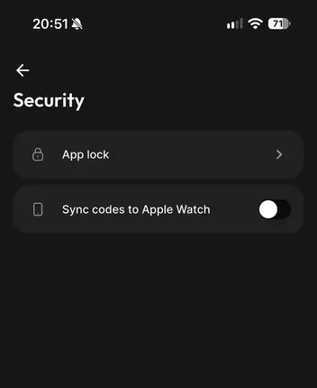
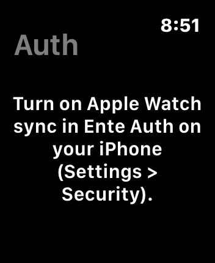
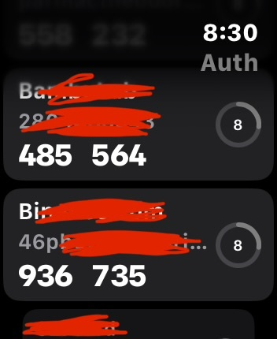
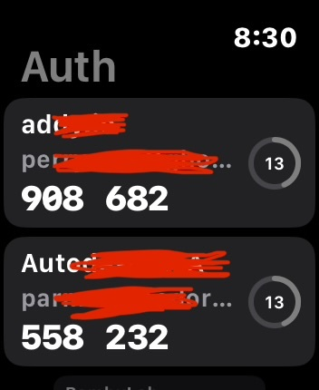

# Custom Ente Auth (POC)
## I DO NOT RECOMMEND YOU INSTALL THIS, IT IS ONLY AS A PROOF OF CONCEPT.

A personal fork of [Ente Auth](https://github.com/ente/ente) for iOS. It adds an Apple Watch app and builds an unsigned IPA that you can sign and sideload yourself.

This repo contains only the Auth app (`mobile/apps/auth`), the shared packages it needs and the Rust code. For Ente Auth itself, see the [upstream repository](https://github.com/ente/ente).

## Screenshots

  
  &nbsp;
  

  
  &nbsp;
  

## What's added

### Apple Watch app

A watchOS app (`mobile/apps/auth/ios/WatchApp`) that shows your TOTP and Steam codes on the watch, with a countdown ring for each one. HOTP codes, trashed codes and codes that fail to parse aren't synced.

- **Off by default.** Turn it on in **Settings → Security → Sync codes to Apple Watch**. Turning it on asks for your phone's authentication first.
- **Sync** runs over WatchConnectivity. Codes are only sent as live messages while the phone and watch are connected, and the system never saves them to disk. The watch keeps its copy in its Keychain, readable only while the watch is unlocked and never synced to other devices.
- **Wiping.** The watch deletes its codes when you turn sync off, log out, or remove the watch passcode.
- **Passcode required.** The watch app won't store or show codes unless the watch has a passcode.
- **Hidden when dimmed.** Codes are hidden on the always-on display and whenever the app isn't in front.
- **Updates need the phone nearby.** New or edited codes only reach the watch while the phone is in range. Codes already on the watch keep working away from the phone.

Code layout:

| Piece | Path |
| --- | --- |
| Dart sync service | `mobile/apps/auth/lib/services/watch_sync_service.dart` |
| iOS bridge (method channel ↔ WatchConnectivity) | `mobile/apps/auth/ios/Runner/WatchBridge.swift` |
| Watch app (SwiftUI, OTP generation, Keychain storage) | `mobile/apps/auth/ios/WatchApp/` |
| Script that added the watch target to the Xcode project | `mobile/apps/auth/scripts/add_watch_target.rb` |

The watch app's bundle ID is `io.ente.auth.watchkitapp`, and it needs watchOS 9 or later.

### Custom bundle IDs

The production server expects the app's package name to start with `io.ente.`. Upstream throws an error if it doesn't. This fork reports `io.ente.auth` instead, so the app still works after you re-sign it with your own bundle ID (`mobile/packages/network/lib/network.dart`).

### Unsigned IPA build (I did this because I do not own a Mac)

`.github/workflows/ios-unsigned.yml` builds the iOS app with the watch app embedded, on every push to `main` or when you run it by hand. The IPA is uploaded as the `EnteAuth-unsigned-ipa` artifact.

- It builds with `xcodebuild archive` instead of `flutter build ios`, because `flutter build ios` forces the iOS SDK onto every target, including the watch app.
- The `simple-icons` submodule isn't tracked here. The workflow fetches it pinned to the same commit upstream uses.

## Installing

1. Download `EnteAuth-unsigned-ipa` from the latest successful run of the workflow.
2. Sign it with your own certificate and provisioning profile (for example with `zsign`). The profile has to cover both the app and the watch app's bundle ID.
3. Install the signed IPA on your iPhone. The watch app installs from the Watch app on the phone.

## License

AGPL-3.0, same as upstream. See [LICENSE](LICENSE).
